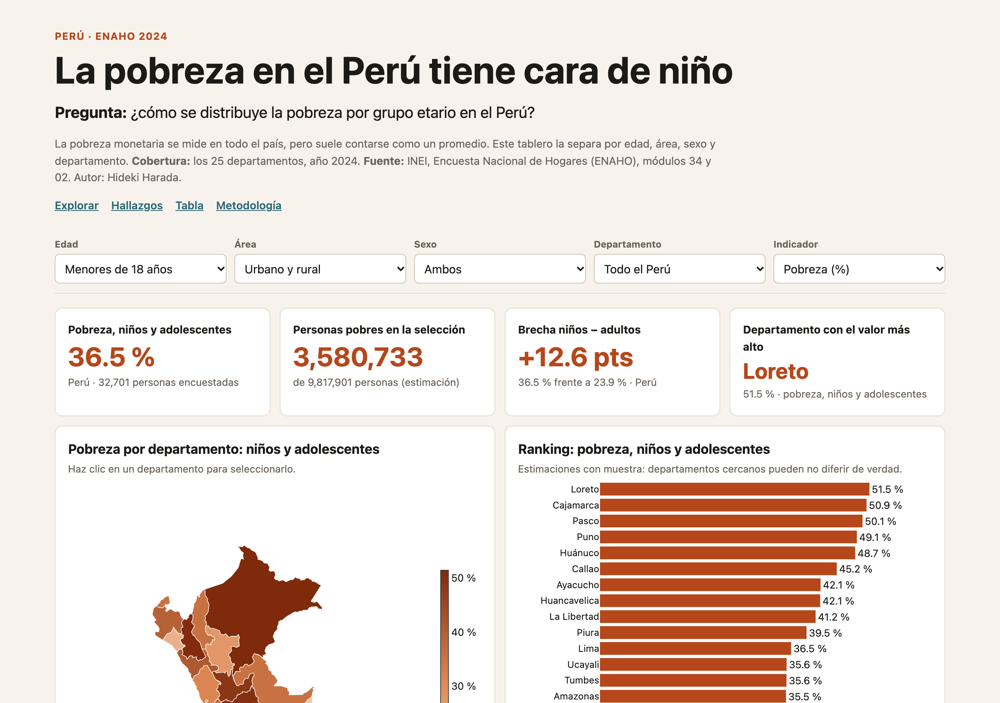
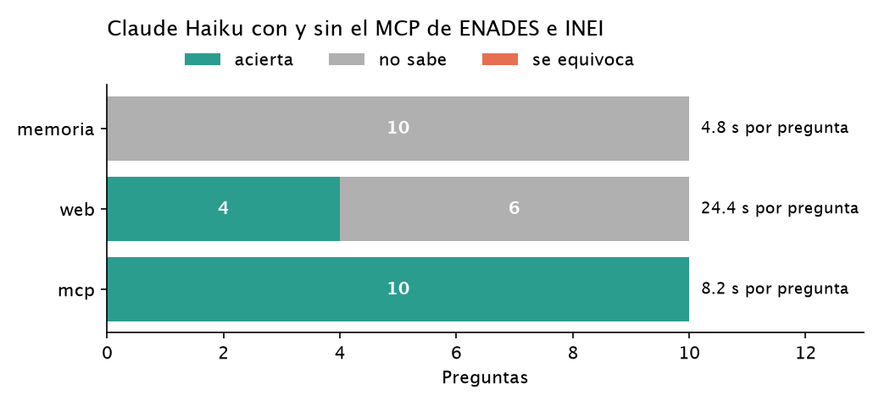
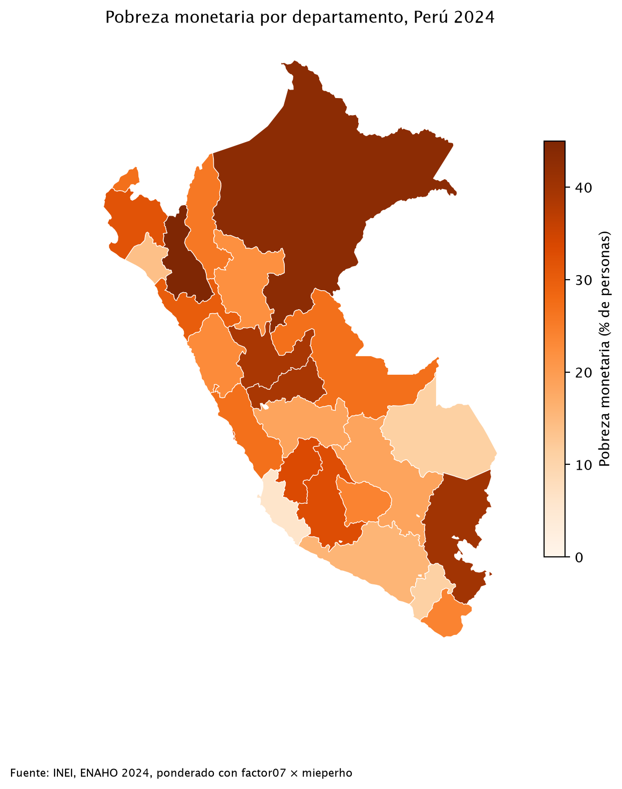

Data projects on poverty, inequality and public opinion in Peru, built with Python and official microdata.

  
  

    
Dashboard · Python

    <h3>In Peru, poverty has a child's face</h3>
    
<strong>Question:</strong> How is monetary poverty distributed across age groups in Peru?

    
<strong>Result:</strong> 36.5% of children under 18 are poor, versus 23.9% of adults. Children are 28.8% of the population but 38.1% of the poor (ENAHO 2024, 95% CIs).

    
<a href="https://github.com/haradaoyakawahideki/pobreza-infantil-peru">Repo</a> · <a href="https://haradaoyakawahideki.github.io/pobreza-infantil-peru/web/">Dashboard</a> · <a href="https://github.com/haradaoyakawahideki/pobreza-infantil-peru/blob/main/reel/reel.mp4">Video</a> <small>(narration generated with AI from my own voice)</small>

  

  
  

    
MCP server · Claude

    <h3>Asking an AI about inequality, with official data</h3>
    
<strong>Question:</strong> Can an AI assistant answer questions about perceived inequality using real survey data instead of guessing?

    
<strong>Result:</strong> An MCP server with weighted figures from ENADES 2026 (IEP/Oxfam, 1,510 interviews) and INEI's official poverty series for 2016–2025, with 8 tests checked against the published reports.

    
<a href="https://github.com/haradaoyakawahideki/mcp-enades">Repo</a>

  

  
  

    
Claude Code skills · Python

    <h3>Three skills that clean, chart and map the ENAHO 2024</h3>
    
<strong>Question:</strong> Can an AI agent clean Peru's national household survey and replicate official poverty figures?

    
<strong>Result:</strong> Yes: 27.6% poverty and 5.5% extreme poverty, matching INEI exactly, across 108,664 residents.

    
<a href="https://github.com/haradaoyakawahideki/diplomado-python-skills">Repo</a>

  

### Live demo: child poverty dashboard

<iframe src="https://haradaoyakawahideki.github.io/pobreza-infantil-peru/web/" title="Child poverty in Peru dashboard (ENAHO 2024)" loading="lazy" style="position:absolute;inset:0;width:100%;height:100%;border:0"></iframe>

<small>Interactive dashboard in Spanish (ENAHO 2024). <a href="https://haradaoyakawahideki.github.io/pobreza-infantil-peru/web/">Open full screen →</a></small>

