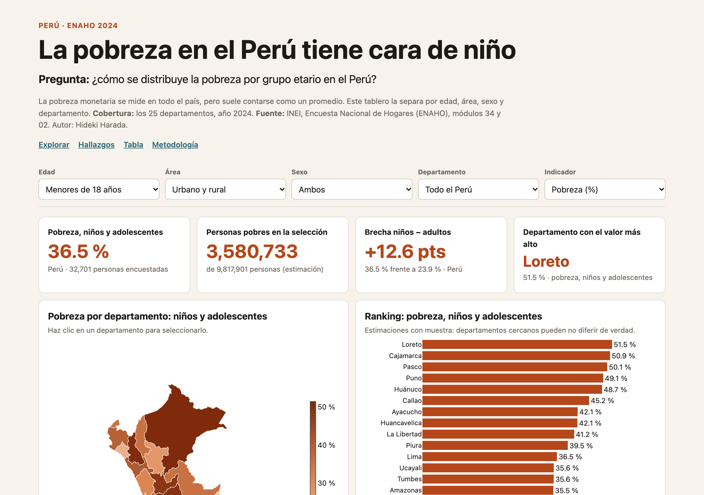
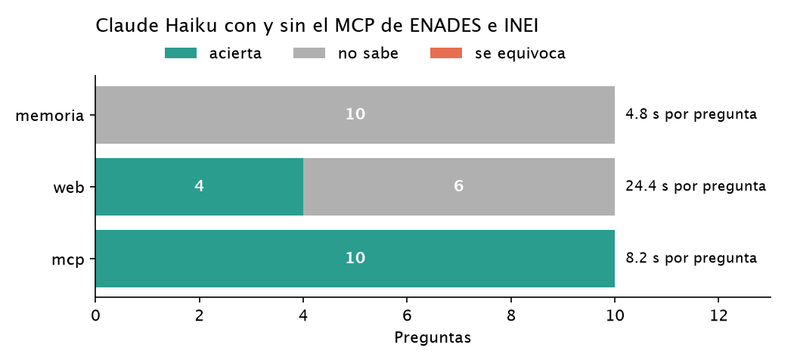
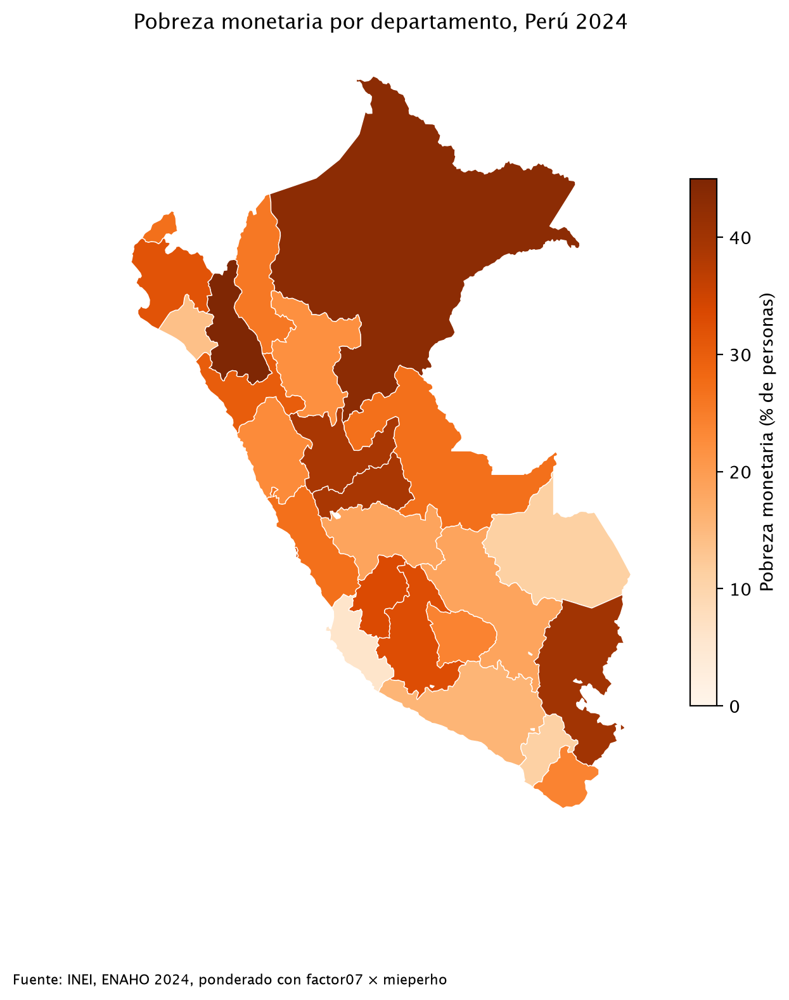

Proyectos de datos sobre pobreza, desigualdad y opinión pública en el Perú, hechos con Python y microdatos oficiales.

  
  

    
Dashboard · Python

    <h3>La pobreza en el Perú tiene cara de niño</h3>
    
<strong>Pregunta:</strong> ¿Cómo se distribuye la pobreza monetaria por grupo de edad en el Perú?

    
<strong>Resultado:</strong> El 36.5 % de los menores de 18 años es pobre, frente al 23.9 % de los adultos. Son el 28.8 % de la población, pero el 38.1 % de los pobres (ENAHO 2024, IC 95 %).

    
<a href="https://github.com/haradaoyakawahideki/pobreza-infantil-peru">Repo</a> · <a href="https://haradaoyakawahideki.github.io/pobreza-infantil-peru/web/">Dashboard</a> · <a href="https://github.com/haradaoyakawahideki/pobreza-infantil-peru/blob/main/reel/reel.mp4">Video</a> <small>(narración generada con IA a partir de mi propia voz)</small>

  

  
  

    
Servidor MCP · Claude

    <h3>Preguntarle a una IA por la desigualdad, con datos oficiales</h3>
    
<strong>Pregunta:</strong> ¿Puede un asistente de IA responder sobre percepción de desigualdad con datos reales de encuesta en lugar de adivinar?

    
<strong>Resultado:</strong> Un servidor MCP con cifras ponderadas de la ENADES 2026 (IEP/Oxfam, 1,510 entrevistas) y la pobreza oficial del INEI 2016–2025, con 8 pruebas contrastadas con los informes publicados.

    
<a href="https://github.com/haradaoyakawahideki/mcp-enades">Repo</a>

  

  
  

    
Skills de Claude Code · Python

    <h3>Tres skills que limpian, grafican y mapean la ENAHO 2024</h3>
    
<strong>Pregunta:</strong> ¿Puede un agente de IA limpiar la ENAHO y replicar la pobreza oficial?

    
<strong>Resultado:</strong> Sí: 27.6 % de pobreza y 5.5 % de pobreza extrema, igual que el INEI, con 108,664 residentes.

    
<a href="https://github.com/haradaoyakawahideki/diplomado-python-skills">Repo</a>

  

### Demo en vivo: dashboard de pobreza infantil

<iframe src="https://haradaoyakawahideki.github.io/pobreza-infantil-peru/web/" title="Dashboard de pobreza infantil en el Perú (ENAHO 2024)" loading="lazy" style="position:absolute;inset:0;width:100%;height:100%;border:0"></iframe>

<small>Dashboard interactivo (ENAHO 2024). <a href="https://haradaoyakawahideki.github.io/pobreza-infantil-peru/web/">Abrir en pantalla completa →</a></small>

